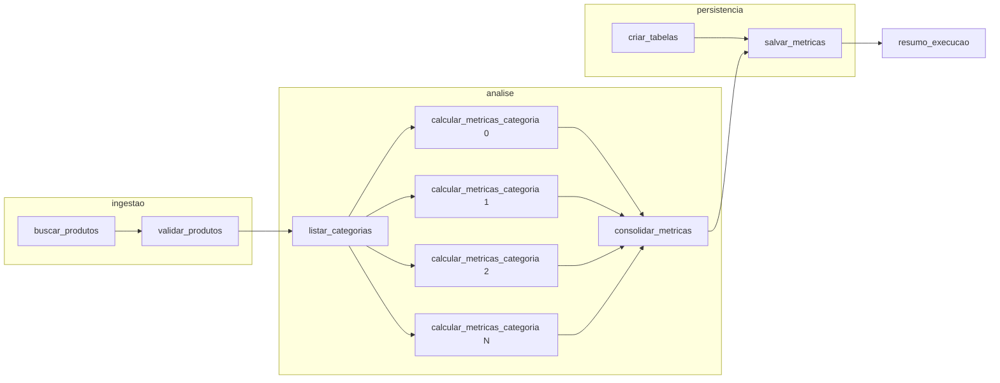

# ShopBrasil - Pipeline de Pricing com Apache Airflow

Atividade 01 da disciplina **Orquestração de Workflows** (Pós-graduação em Engenharia de IA e MLOps - PUC Minas).

## O problema

O time de pricing da ShopBrasil começa o dia olhando um painel com o panorama de preços por categoria (preço médio, mínimo, máximo e quantidade de produtos). Esse painel era alimentado por um script Python rodando via cron, que:

- falhava em silêncio quando a API de catálogo oscilava de madrugada;
- duplicava os números quando alguém rodava o script de novo "na mão";
- precisava ser editado toda vez que surgia uma categoria nova.

Este projeto substitui o script por uma DAG no Apache Airflow que roda sozinha todo dia às 06:00 (horário de Brasília), tenta de novo quando a API falha, se adapta a novas categorias, não duplica dados e avisa quando algo dá errado.

## Stack

- Apache Airflow 2.10.5 (Python 3.11, LocalExecutor)
- PostgreSQL 16 (metadados do Airflow + banco analítico `shopbrasil`)
- Docker Compose
- Fonte de dados: [FakeStore API](https://fakestoreapi.com/docs) (`/products`)

## Como o workflow funciona



A DAG `shopbrasil_pricing_pipeline` é escrita com a TaskFlow API (`@dag`, `@task`, `@task_group`). As dependências saem da própria chamada das funções e os dados passam entre as tasks por XCom, via `return`.

### 1. Ingestão (`ingestao`)

| Task | O que faz |
|---|---|
| `buscar_produtos` | Faz o GET em `https://fakestoreapi.com/products`. É a task crítica: tem `retries=4` com `retry_exponential_backoff` (30s, 60s, 120s, 240s, limitado a 5 min), `try/except` que relança a exceção para acionar o retry e os callbacks `on_success_callback`, `on_retry_callback` e `on_failure_callback`. |
| `validar_produtos` | Usa o operador customizado `ValidarProdutosOperator` para conferir o schema de cada produto (`id`, `title`, `price` >= 0 e `category` preenchida). Se algum produto estiver inválido, a task falha e nada segue adiante. |

### 2. Análise (`analise`)

| Task | O que faz |
|---|---|
| `listar_categorias` | Descobre as categorias presentes nos dados e agrupa os preços de cada uma. Retorna só `{categoria, precos}`, mantendo o XCom pequeno. |
| `calcular_metricas_categoria` | **Fan-out** com Dynamic Task Mapping (`.expand`): uma instância por categoria, criada em tempo de execução. Usa o pool `ecommerce_pool` (2 slots), então no máximo duas categorias são processadas ao mesmo tempo. |
| `consolidar_metricas` | **Fan-in**: junta as métricas de todas as categorias numa lista única. |

### 3. Persistência (`persistencia`)

| Task | O que faz |
|---|---|
| `criar_tabelas` | Cria as tabelas (se ainda não existirem) usando `PostgresHook` com a Connection `shopbrasil_postgres`. |
| `salvar_metricas` | Grava o snapshot e o histórico numa única transação. |

### 4. `resumo_execucao`

Registra quantas categorias foram persistidas. Tem SLA de 1 hora: se o pipeline das 06:00 não terminar até as 07:00, o `sla_miss_callback` dispara um alerta.

### Topologias

- **Linear:** `ingestao -> analise -> persistencia -> resumo_execucao`
- **Fan-out:** `listar_categorias -> calcular_metricas_categoria[0..N]`
- **Fan-in:** `calcular_metricas_categoria[0..N] -> consolidar_metricas`

## Decisões de projeto

**Agendamento.** `schedule="0 6 * * *"` com `start_date` criado via `pendulum` no fuso `America/Sao_Paulo` e `catchup=False`. Com isso, a DAG roda às 06:00 de Brasília e não tenta recuperar execuções antigas quando é ligada.

**Idempotência.** A tabela `pricing_categoria_snapshot` tem chave primária `(data_referencia, categoria)` e a gravação usa `INSERT ... ON CONFLICT DO UPDATE`. Reprocessar o mesmo dia atualiza as linhas em vez de duplicá-las.

**Histórico de preços.** A tabela `pricing_categoria_historico` recebe uma linha por execução e categoria (modo append), para acompanhar a evolução dos preços ao longo do tempo. A restrição `UNIQUE (dag_run_id, categoria)` garante que reprocessar a mesma run não repete linhas.

**Data de referência.** `data_referencia` é a data (em Brasília) de `data_interval_end`, ou seja, o dia em que a execução das 06:00 acontece. Numa execução manual, é o dia do disparo.

**Alertas.** O `on_failure_callback` está nos `default_args`, então qualquer task que falhar gera um alerta. Como o projeto não tem Slack ou e-mail configurados, o envio é simulado no log com a marcação `[ALERTA SIMULADO]`.

**Escalabilidade.** Nenhuma categoria está fixa no código. Se a API passar a retornar uma categoria nova, o mapeamento dinâmico cria uma task a mais automaticamente.

## Requisitos da atividade

### Obrigatórios

| Requisito | Implementação |
|---|---|
| TaskFlow API e XComs automáticos | `@dag`, `@task`, `@task_group` e `return` em todas as tasks |
| Topologias linear, fan-out e fan-in | ver seção "Topologias" |
| Timezone `America/Sao_Paulo`, `start_date`, `catchup=False` | parâmetros do `@dag` |
| Retry com exponential backoff | `buscar_produtos` |
| `try/except` + `raise` | `buscar_produtos` |
| Callbacks de falha, retry e sucesso | `buscar_produtos` |
| Dynamic Task Mapping | `calcular_metricas_categoria.expand(...)` |
| Pool `ecommerce_pool` com 2 slots | criado no `airflow-init` e usado em `calcular_metricas_categoria` |
| Pelo menos 2 TaskGroups | `ingestao`, `analise` e `persistencia` |
| `PostgresHook` + Connection | `shopbrasil_postgres` |
| Gravação idempotente | `UPSERT` no snapshot |

### Opcionais

| Requisito | Implementação |
|---|---|
| `ValidarProdutosOperator(BaseOperator)` | `plugins/operators/validar_produtos_operator.py` |
| Tabela de histórico em append | `pricing_categoria_historico` |
| SLA / alerta | `on_failure_callback` com alerta simulado e `sla` + `sla_miss_callback` em `resumo_execucao` |

## Como executar

Pré-requisitos: Docker e Docker Compose v2, com as portas `8080` e `5432` livres.

```bash
cp .env.example .env
mkdir -p logs

docker compose up airflow-init
docker compose up -d postgres airflow-webserver airflow-scheduler
```

No Linux, ajuste `AIRFLOW_UID` no `.env` com o resultado de `id -u` para evitar problemas de permissão na pasta `logs/`.

O serviço `airflow-init` prepara o banco do Airflow e cria o usuário admin, a Connection `shopbrasil_postgres` e o pool `ecommerce_pool` com 2 slots.

Acesse `http://localhost:8080` com usuário `airflow` e senha `airflow`, ative a DAG `shopbrasil_pricing_pipeline` e dispare uma execução manual. A partir daí ela roda sozinha todo dia às 06:00.

Para parar o ambiente, use `docker compose down`. Para parar e apagar os dados, use `docker compose down -v`.

## Como validar

### Resultado no banco

```bash
docker compose exec postgres psql -U airflow -d shopbrasil
```

```sql
SELECT * FROM pricing_categoria_snapshot ORDER BY data_referencia DESC, categoria;
SELECT * FROM pricing_categoria_historico ORDER BY criado_em DESC, categoria;
```

Outras consultas, incluindo a que verifica duplicidade, estão em `include/consultas_validacao.sql`.

### Idempotência

1. Execute a DAG e anote a quantidade de linhas das duas tabelas.
2. Na mesma execução, use **Clear** na task `persistencia.salvar_metricas`.
3. Depois que ela rodar de novo, as contagens continuam iguais.

### Retry, backoff e callbacks

A task `buscar_produtos` aceita um modo de teste, que só vale em execuções manuais. Use **Trigger DAG w/ config** com:

| Config | Resultado esperado |
|---|---|
| `{"modo_teste": "falha_uma_vez"}` | falha na 1ª tentativa (`[RETRY]` no log) e conclui na 2ª (`[SUCCESS]`) |
| `{"modo_teste": "falha_permanente"}` | falha nas 5 tentativas, com intervalos crescentes, e termina com `[ALERTA SIMULADO]` |

### Pool

Durante uma execução, acompanhe **Admin -> Pools**: o `ecommerce_pool` nunca passa de 2 tasks rodando. As instâncias de `calcular_metricas_categoria` começam de duas em duas.

## Estrutura do projeto

```text
.
├── dags/
│   └── shopbrasil_pricing_pipeline.py   # DAG principal
├── plugins/
│   └── operators/
│       └── validar_produtos_operator.py # operador customizado
├── include/
│   └── consultas_validacao.sql          # consultas de conferência
├── sql/
│   └── init-databases.sh                # cria o banco analítico
├── .env.example
├── docker-compose.yml
├── requirements.txt
└── README.md
```
